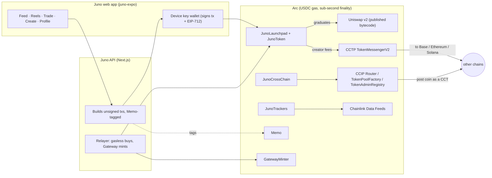

Hosted Arc testnet: https://juno-arc.vercel.app · [Vercel checks and storage limitation](docs/HOSTED.md).

# Juno on Arc — every post is a market

Live contracts: Arc testnet. The former hosting was removed; public Vercel hosting is pending.
Browser reproduction and current evidence: [docs/JUDGE-REPORT.md](docs/JUDGE-REPORT.md).


**Post a photo or a reel and it launches its own token on a USDC bonding curve
on Arc.** People buy into the post as they scroll — each buy final in about a
second (Arc blocks land every ~0.5 s), gas about half a cent of USDC — the creator earns the trading fees
and withdraws them to any chain through Circle CCTP, and when the curve fills
it graduates into a locked Uniswap v2 pair. A graduated post coin can then
become a **Chainlink CCIP Cross-Chain Token** that holders bridge to Base or
Ethereum.

Built for the [Arc Microgrants](https://dorahacks.io/hackathon/arc-microgrants/detail).
Ported from Juno on Monad (same team); this repository is a fresh port with its
own history.

| | |
|---|---|
| **Network** | Arc **testnet** (chain 5042002), deployed and exercised with real transactions: [docs/E2E-TESTNET.md](docs/E2E-TESTNET.md). Arc **mainnet** (5042) is one command, not yet run — see [MAINNET.md](MAINNET.md). |
| **Contracts** | [`contracts/`](contracts/) — `JunoLaunchpad`, `JunoToken`, `UniswapV2Graduator`, `JunoSwapRouter`, `JunoCrossChain`, `JunoTrackers`, plus Uniswap's published v2 factory + Router02. Addresses: [`deployments/`](deployments/). |
| **App** | [`juno-expo/`](juno-expo/) — the web app (Expo / React Native Web). |
| **API** | [`app/api/juno/`](app/api/juno/) — the Next.js server: builds unsigned transactions, relays gasless buys, talks to Circle Gateway / Iris and Chainlink. [docs/API.md](docs/API.md). |
| **Deep dive** | [JUNO.md](JUNO.md) — the curve, the contracts, CCIP, CCTP, trackers, admin powers. |

## Arc stack

Each row says what has been **run on Arc testnet** with real transactions (hashes in
[docs/E2E-TESTNET.md](docs/E2E-TESTNET.md)), what is **fork-proven** (a fork of Arc testnet or mainnet state, not a live
transaction), and what is **not verified**. Nothing here has been run on Arc mainnet.

| Piece | What it does in Juno | Contract / file | How it's verified |
|---|---|---|---|
| **USDC as gas + quote** | Every curve is priced in USDC (6-dec ERC-20 at `0x3600…0000`); gas is USDC too, so a user holds exactly one token. No native-coin path anywhere (Arc's 18-dec native face never mixes with the 6-dec ERC-20). | `JunoLaunchpad.sol`, `lib/juno/` | **Run on testnet:** launch, buys, sell and fee claim all paid their gas in USDC (a buy cost ≈ $0.004, a launch ≈ $0.06). Also 85 Foundry tests on Circle's real FiatToken v2.2 bytecode etched at `0x3600…`; fork suite on Arc testnet's live USDC |
| **Sub-second finality** | A buy is final before you scroll to the next post: the receipt is the confirmation, and the app shows the measured ms, the gas in USDC and the explorer link. | `lib/juno/tx.ts` (`confirmMs`), `juno-expo/components/SpeedReceipt.tsx` | **Run on testnet:** blocks land about every 0.5 s and a receipt is final, but the **measured submit-to-receipt time through Juno's server is 1.1–1.3 s** (RPC round trips and polling included), not under a second. The fork e2e (`scripts/e2e-fork.mjs`) and browser pass (`docs/screens/arc/`) time the fork's own 1 s blocks |
| **Chainlink CCIP — Cross-Chain Tokens** (headline) | After graduation the creator makes the post coin a CCT in **one transaction**: Arc's TokenPoolFactory deploys Chainlink's published BurnMintTokenPool 2.0.0, RegistryModuleOwnerCustom + TokenAdminRegistry register it, capped rate limits are always on. Holders then send it to Base / Ethereum paying the CCIP fee in USDC. Arc supply can never exceed the launch supply (`ccipMinted ≤ ccipBurned`). | `JunoCrossChain.sol`, `JunoToken.sol`, `lib/juno/ccip.ts`, `scripts/ccip-remote.ts`, `ccip-send.ts`, `ccip-status.ts` | Chainlink Local + published CCIP bytecode: Arc → Base → Arc round trip (`test/JunoCrossChain.t.sol`); **Arc testnet fork: enable through the real factory/registries and a real `ccipSend` to Base Sepolia via OnRamp 2.0** (forge fork suite and the API e2e, fee ≈ 0.26 USDC); delivery on Base Sepolia and the remote-chain deploy are user-run. **Not run live on testnet:** enabling needs a graduated coin (about $28 of buys to fill the curve), so enable/send are fork-proven only; the CCIP contracts (`JunoCrossChain`) are deployed on testnet |
| **Circle Gateway** | A buyer with USDC on any Gateway chain signs one burn intent; Circle attests, Juno's relayer mints on Arc, and the buy follows — no bridge UI, no chain switch. Deposits from Arc too. | `lib/juno/gateway.ts`, `/api/juno/gateway/*`, `juno-expo/components/Gateway.tsx` | Gateway deposit on the Arc testnet fork (forge + API e2e); intent building/validation unit tests; the API's signed burn intent reaches Circle's real Gateway API (refused there only because the deposit exists on the fork); a live attestation + mint needs a real Gateway balance (user-run). **Run on testnet:** a real deposit from Arc into the GatewayWallet (0.02 USDC, `availableBalance` read back); attestation and mint were **not** run |
| **Gasless buys (EIP-3009)** | The buyer signs one `ReceiveWithAuthorization` bound to the exact trade; the relayer submits `buyWithAuthorization` and pays the USDC gas. Pairs with Gateway: USDC lands, the buy needs no gas and no approval. | `JunoLaunchpad.buyWithAuthorization`, `lib/juno/gasless.ts`, `/api/juno/tx/buy-intent`, `buy-relayed` | **Run on testnet:** one relayed buy; the buyer paid exactly the trade and no gas. Also unit tests on FiatToken v2.2 (binding, replay, refunds); fork test on Arc testnet USDC |
| **CCTP V2** | Creators withdraw their fees straight to Base, Ethereum, Arbitrum, Solana… in one call: the launchpad burns through TokenMessengerV2 for the creator's wallet on the destination. | `JunoLaunchpad.claimCreatorFeesCrossChain`, `lib/juno/cctp.ts`, `/api/juno/tx/claim`, `/api/juno/cctp/status` | Unit tests; the Arc testnet fork burns through the real TokenMessengerV2 (forge and API e2e); **Run on testnet:** a real `depositForBurn` toward Base Sepolia that Circle's Iris sandbox then attested (status `complete`); the mint on Base Sepolia needs a Base Sepolia transaction and was **not** completed (user-run) |
| **Chainlink Data Feeds** | Tracker coins (BTC, ETH, SOL, LINK, PAXG gold, EUR, JPY…) are recorded against a Chainlink feed on chain and marked with premium/band and staleness checks (on Arc **mainnet**, where the feeds exist); the app shows the USDC/USD peg from Chainlink. | `JunoTrackers.sol`, `lib/juno/chainlink.ts`, `/api/juno/trackers`, `/api/juno/peg` | Chainlink Local mocks in unit tests; **Arc mainnet fork against the live BTC/USD feed** (`test/fork/ArcMainnetFeeds.t.sol`); the API reads the 10 live mainnet feeds. **Display-only on testnet:** Arc testnet has no Chainlink feeds (`feedsRegistered: 0`), so testnet trackers show mainnet prices, keep the ratio in Juno's database and are not marked on chain; the app says so. Not run live on testnet |
| **Arc Memo** | Curve trades (and relayed buys) go through Arc's Memo predeploy tagged `keccak256("juno:post:<token>")`, so every payment reconciles to the post it bought into; the receipt shows the tag. | `lib/juno/memo.ts`, `/api/juno/tx/swap` | `forge test --network arc` fork test (CallFrom keeps the buyer as `msg.sender`); **Run on testnet:** the launch, buy, sell and relayed buy were all Memo-tagged (Memo is live on testnet). Memo-wrapped buys, sells and relayed buys also in the API e2e on the Arc Foundry fork. The server probes Memo once and falls back to a plain call on a node without CallFrom |
| **Uniswap v2 on Arc** | Arc has no Uniswap; Juno deploys Uniswap's own published v2 factory + Router02 byte for byte (canonical init code hash) and graduates into it with the LP burned. | `script/Deploy.s.sol`, `script/lib/Artifacts.sol`, `UniswapV2Graduator.sol` | Factory and router are **deployed on testnet** from the published bytecode; unit + parity tests on the artifacts. **Graduation and v2 trading are fork-proven only** (graduating needs about $28 of buys: not run live) |

## Deployed on Arc testnet

Chain 5042002, deployer `0x0648…1FBd`; the record is [`deployments/arc-testnet.json`](deployments/arc-testnet.json).

| Contract | Address | Explorer source |
|---|---|---|
| JunoLaunchpad | [`0xcE806E4bf02ef60bd960D25a170E97BEc9870141`](https://explorer.testnet.arc.io/address/0xcE806E4bf02ef60bd960D25a170E97BEc9870141) | **Verified** (Blockscout, source + ABI) |
| UniswapV2Graduator | [`0xd7Bf04137472BC9Bb6D76af795DC05c6696E1356`](https://explorer.testnet.arc.io/address/0xd7Bf04137472BC9Bb6D76af795DC05c6696E1356) | Not source-verified yet (explorer rate limit): `VERIFY=1 sh scripts/deploy.sh testnet` |
| JunoCrossChain (CCIP) | [`0x8aA2fD0F5f928D7b0ee8F32a616e968689212Bc3`](https://explorer.testnet.arc.io/address/0x8aA2fD0F5f928D7b0ee8F32a616e968689212Bc3) | Not source-verified yet (explorer rate limit): `VERIFY=1 sh scripts/deploy.sh testnet` |
| JunoSwapRouter | [`0x5F368a741F490F365fB9b72a1707bee7a03AD851`](https://explorer.testnet.arc.io/address/0x5F368a741F490F365fB9b72a1707bee7a03AD851) | Not source-verified yet (explorer rate limit): `VERIFY=1 sh scripts/deploy.sh testnet` |
| JunoTrackers | [`0x804C0f6F302a71cF36346a2F6936E034ea95EaAD`](https://explorer.testnet.arc.io/address/0x804C0f6F302a71cF36346a2F6936E034ea95EaAD) | Not source-verified yet (explorer rate limit): `VERIFY=1 sh scripts/deploy.sh testnet` |
| Uniswap v2 factory / Router02 | [`0xDe99…FFC`](https://explorer.testnet.arc.io/address/0xDe99BF4827C7c7860DE8e5b9e204B4f94dD1cFFC) / [`0x9A11…a86`](https://explorer.testnet.arc.io/address/0x9A110BeEe29e24C40CB993154286613D827f1a86) | Uniswap's published bytecode, deployed unmodified |

A launch, buys, a relayed gasless buy, a sell, fee claims, a CCTP burn and a Gateway deposit were run on it with real
transactions: [docs/E2E-TESTNET.md](docs/E2E-TESTNET.md) (links to every transaction). The judge's report and the claim-by-claim
audit are in [docs/JUDGE-REPORT.md](docs/JUDGE-REPORT.md); a cold-open guide is [docs/JUDGE-WALKTHROUGH.md](docs/JUDGE-WALKTHROUGH.md).
Photos and reels are limited to 4MB. With `PINATA_JWT`, uploads are pinned to IPFS. Without it, labelled demo storage
uses the existing Mongo database on Vercel (`JUNO_MEDIA_BACKEND=mongo` locally), or local disk.
Demo metadata uses a resolvable content-addressed HTTP(S) URL. Set `JUNO_API_URL` to the public API origin before hosted launches.

## How it works



The server never holds a user's key: it builds, the wallet signs, the server
submits and records what the receipt says. The only server key is the relayer,
which pays USDC gas for gasless buys and Gateway mints and can't redirect a
cent (the buyer's signature names the trade and the recipient).

## Run it locally (Arc testnet fork, no keys, no testnet USDC)

Needs Node 22+, PostgreSQL 16, MongoDB 7 and Circle's [Arc Foundry](https://github.com/circlefin/arc-foundry)
(`anvil`/`forge`/`cast` with `--network arc`).

```bash
git clone --recurse-submodules <this repo> && cd juno-arc
npm install && (cd contracts && npm ci) && (cd juno-expo && npm install)
export ARC_ANVIL=/path/to/arc-foundry/anvil FORGE=/path/to/arc-foundry/forge CAST=/path/to/arc-foundry/cast
(cd juno-expo && EXPO_PUBLIC_API_URL=http://127.0.0.1:8911 npx expo export --platform web --clear)
npm run demo:local          # fork :8910 (deploys with the real script), API :8911, web app :8912, mongod :8913, seeded content
npm run demo:local -- stop
node scripts/e2e-fork.mjs   # the main flow over the API with real signed txs on the fork
```

## Run it against Arc testnet (real transactions)

```bash
cp .env.example .env.local     # NEXT_PUBLIC_ARC_NETWORK=testnet, ARC_RPC_URL=https://rpc.testnet.arc.io, a funded
                               # JUNO_RELAYER_PRIVATE_KEY (a few cents of testnet USDC), DATABASE_URL, MONGODB_URI
npm run build && npx next start -p 8911
(cd juno-expo && EXPO_PUBLIC_API_URL=http://127.0.0.1:8911 npx expo export --platform web --output-dir dist-testnet)
ARC_RPC_URL=https://rpc.testnet.arc.io node scripts/e2e-testnet.mjs   # ~0.4 testnet USDC net, funded from the deployer file
```

## Tests

| Suite | Command | Result (2026-10-08 unless dated) |
|---|---|---|
| Contracts (unit + Chainlink Local) | `cd contracts && forge test` | 85 passed, 2 skipped (fork-gated; re-run 2026-10-14) |
| Contracts on Arc forks (testnet + mainnet state) | `FORK_TESTS=1 forge test --network arc --match-path 'test/fork/*'` | 10 passed |
| Slither | `slither . --filter-paths "lib/\|test/\|script/\|node_modules/" --exclude-dependencies --fail-medium` | no medium/high |
| Server + app unit | `npx vitest run tests/unit` | 407 passed (round 2, 2026-10-14) |
| Integration (against the fork) | `JUNO_DEPLOYMENT_FILE=.fork/arc-fork.json ARC_RPC_URL=http://127.0.0.1:8910 npx vitest run tests/integration` | 11 passed, 1 skipped |
| Typecheck / lint / build | `npx tsc --noEmit`, `(cd juno-expo && npx tsc --noEmit)`, `npm run lint`, `npm run build`, `expo export --platform web` | clean / 0 |
| API end to end on the fork | `node scripts/e2e-fork.mjs` | 12 sections, 20 signed txs, all passed ([docs/E2E-FORK.md](docs/E2E-FORK.md)) |
| API end to end on **Arc testnet** (real txs) | `ARC_RPC_URL=https://rpc.testnet.arc.io node scripts/e2e-testnet.mjs` | passed twice, 2026-10-13/14: launch, buy, relayed buy, sell, fee claim, CCTP burn, Gateway deposit ([docs/E2E-TESTNET.md](docs/E2E-TESTNET.md)) |

Screens: from the browser pass on the fork [`docs/screens/arc/`](docs/screens/arc/); against the real testnet deployment, desktop and 390 px, every route plus the launch flow [`docs/screens/testnet/`](docs/screens/testnet/).

## Deploy

```bash
sh scripts/deploy.sh testnet                              # needs ~1 USDC of testnet gas on the deployer
JUNO_CONFIRM_MAINNET=yes sh scripts/deploy.sh mainnet     # see MAINNET.md
```

## Layout

| Path | What |
|---|---|
| `contracts/` | Foundry: contracts, unit tests, fork suites (`test/fork/`), `script/Deploy.s.sol`. |
| `juno-expo/` | The web app. |
| `app/api/juno/`, `lib/juno/` | API routes and the chain/data layer. |
| `scripts/` | Deploy, fork rehearsal, local demo, e2e, CCIP remote deploy/send/status, CLI tools. |
| `deployments/` | `arc-testnet.json`, `arc-mainnet.json`. |
| `indexer/` | Optional Envio indexer (not verified on Arc). |

## Credits

External code under its own licences: OpenZeppelin, forge-std, Uniswap v2
(published bytecode, GPL-3.0), Chainlink CCIP / Chainlink Local (published
bytecode and interfaces), Circle FiatToken v2.2 bytecode in tests. Most code and
docs were written with Claude Code (Anthropic) under the author's direction.

MIT — see [LICENSE](LICENSE).

<!-- MAINNET-ADDRESSES -->
## Addresses — live mainnet and testnet

Mainnet **5042: Live**, deployed 2026-10-14. [All mainnet addresses and transaction receipts](docs/MAINNET-DEPLOYMENT.md).
Testnet **5042002: Live**; [testnet deployment](deployments/arc-testnet.json) and [testnet evidence](docs/E2E-TESTNET.md).

- ccipRegistryModuleOwnerCustom: [0x3201a20D2a33820C0DaC8Bc93C4819755C2a8c7F](https://explorer.arc.io/address/0x3201a20D2a33820C0DaC8Bc93C4819755C2a8c7F).
- ccipRouter: [0xB79791184973589c38e114D43Eb8E4588C283A18](https://explorer.arc.io/address/0xB79791184973589c38e114D43Eb8E4588C283A18).
- ccipTokenAdminRegistry: [0x51e2A24742Db77604B881d6781Ee16B5b8fcBE29](https://explorer.arc.io/address/0x51e2A24742Db77604B881d6781Ee16B5b8fcBE29).
- ccipTokenPoolFactory: [0x7CcFb2Fa43637b4858Cb1269CF0d64a99e8C668a](https://explorer.arc.io/address/0x7CcFb2Fa43637b4858Cb1269CF0d64a99e8C668a).
- crossChain: [0xeBFD4d58972e5231FB816515198fC4E63593091b](https://explorer.arc.io/address/0xeBFD4d58972e5231FB816515198fC4E63593091b).
- gatewayMinter: [0x2222222d7164433c4C09B0b0D809a9b52C04C205](https://explorer.arc.io/address/0x2222222d7164433c4C09B0b0D809a9b52C04C205).
- gatewayWallet: [0x77777777Dcc4d5A8B6E418Fd04D8997ef11000eE](https://explorer.arc.io/address/0x77777777Dcc4d5A8B6E418Fd04D8997ef11000eE).
- graduator: [0x524874735655963a82F160Cb741153F50CdebcF6](https://explorer.arc.io/address/0x524874735655963a82F160Cb741153F50CdebcF6).
- launchpad: [0x52D364dF075CEC807f854d2f7D7ff8485dedf641](https://explorer.arc.io/address/0x52D364dF075CEC807f854d2f7D7ff8485dedf641).
- memo: [0x5294E9927c3306DcBaDb03fe70b92e01cCede505](https://explorer.arc.io/address/0x5294E9927c3306DcBaDb03fe70b92e01cCede505).
- swapRouter: [0x90948fda347bBF1fb6f2A6F7Cd4765D6ffD7cfBe](https://explorer.arc.io/address/0x90948fda347bBF1fb6f2A6F7Cd4765D6ffD7cfBe).
- tokenMessengerV2: [0x28b5a0e9C621a5BadaA536219b3a228C8168cf5d](https://explorer.arc.io/address/0x28b5a0e9C621a5BadaA536219b3a228C8168cf5d).
- trackers: [0x05Ff7d5cfd43b714e4abA00493459A600320a406](https://explorer.arc.io/address/0x05Ff7d5cfd43b714e4abA00493459A600320a406).
- uniswapV2Factory: [0x1294aF729364c40F43A891e92E9A2196D3385c77](https://explorer.arc.io/address/0x1294aF729364c40F43A891e92E9A2196D3385c77).
- uniswapV2Router02: [0x29CAa1fa4a9456d5B511e4607033026FE512CD09](https://explorer.arc.io/address/0x29CAa1fa4a9456d5B511e4607033026FE512CD09).

Mainnet smoke: [Smoke: launch content coin with zero purchase](https://explorer.arc.io/tx/0xfde385889cc303e46ee7c132b2c5cfd1f33ef9e6d396448210a51ebd6e688143).
<!-- /MAINNET-ADDRESSES -->
