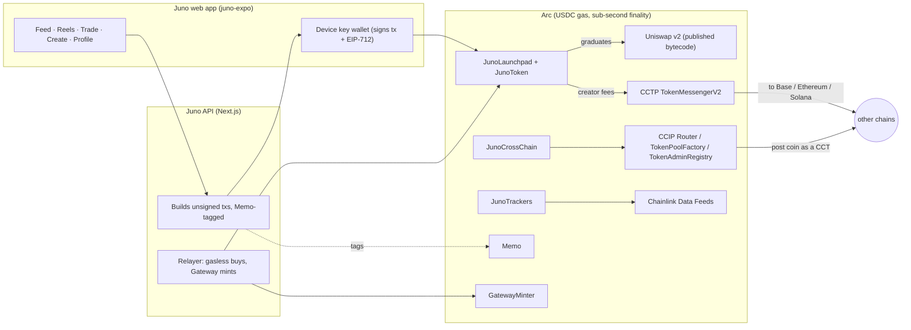

# Juno on Arc — every post is a market

**Post a photo or a reel and it launches its own token on a USDC bonding curve
on Arc.** People buy into the post as they scroll — each buy final in under a
second, gas a fraction of a cent of USDC — the creator earns the trading fees
and withdraws them to any chain through Circle CCTP, and when the curve fills
it graduates into a locked Uniswap v2 pair. A graduated post coin can then
become a **Chainlink CCIP Cross-Chain Token** that holders bridge to Base or
Ethereum.

Built for the [Arc Microgrants](https://dorahacks.io/hackathon/arc-microgrants/detail).
Ported from Juno on Monad (same team); this repository is a fresh port with its
own history.

| | |
|---|---|
| **Network** | Arc **testnet** (chain 5042002) now; Arc **mainnet** (5042) is one command — see [MAINNET.md](MAINNET.md). |
| **Contracts** | [`contracts/`](contracts/) — `JunoLaunchpad`, `JunoToken`, `UniswapV2Graduator`, `JunoSwapRouter`, `JunoCrossChain`, `JunoTrackers`, plus Uniswap's published v2 factory + Router02. Addresses: [`deployments/`](deployments/). |
| **App** | [`juno-expo/`](juno-expo/) — the web app (Expo / React Native Web). |
| **API** | [`app/api/juno/`](app/api/juno/) — the Next.js server: builds unsigned transactions, relays gasless buys, talks to Circle Gateway / Iris and Chainlink. [docs/API.md](docs/API.md). |
| **Deep dive** | [JUNO.md](JUNO.md) — the curve, the contracts, CCIP, CCTP, trackers, admin powers. |

## Arc stack

| Piece | What it does in Juno | Contract / file | How it's verified |
|---|---|---|---|
| **USDC as gas + quote** | Every curve is priced in USDC (6-dec ERC-20 at `0x3600…0000`); gas is USDC too, so a user holds exactly one token. No native-coin path anywhere (Arc's 18-dec native face never mixes with the 6-dec ERC-20). | `JunoLaunchpad.sol`, `lib/juno/` | 85 Foundry tests on Circle's real FiatToken v2.2 bytecode etched at `0x3600…`; fork suite on Arc testnet's live USDC |
| **Sub-second finality** | A buy is final before you scroll to the next post: the receipt is the confirmation, and the app shows the measured ms, the gas in USDC and the explorer link. | `lib/juno/tx.ts` (`confirmMs`), `juno-expo/components/SpeedReceipt.tsx` | `scripts/e2e-fork.mjs` (20 signed txs) and a browser pass on the Arc fork (`docs/screens/arc/`); fork timings are the fork's 1 s blocks, not Arc's |
| **Chainlink CCIP — Cross-Chain Tokens** (headline) | After graduation the creator makes the post coin a CCT in **one transaction**: Arc's TokenPoolFactory deploys Chainlink's published BurnMintTokenPool 2.0.0, RegistryModuleOwnerCustom + TokenAdminRegistry register it, capped rate limits are always on. Holders then send it to Base / Ethereum paying the CCIP fee in USDC. Arc supply can never exceed the launch supply (`ccipMinted ≤ ccipBurned`). | `JunoCrossChain.sol`, `JunoToken.sol`, `lib/juno/ccip.ts`, `scripts/ccip-remote.ts`, `ccip-send.ts`, `ccip-status.ts` | Chainlink Local + published CCIP bytecode: Arc → Base → Arc round trip (`test/JunoCrossChain.t.sol`); **Arc testnet fork: enable through the real factory/registries and a real `ccipSend` to Base Sepolia via OnRamp 2.0** (forge fork suite and the API e2e, fee ≈ 0.26 USDC); delivery on Base Sepolia and the remote-chain deploy are user-run |
| **Circle Gateway** | A buyer with USDC on any Gateway chain signs one burn intent; Circle attests, Juno's relayer mints on Arc, and the buy follows — no bridge UI, no chain switch. Deposits from Arc too. | `lib/juno/gateway.ts`, `/api/juno/gateway/*`, `juno-expo/components/Gateway.tsx` | Gateway deposit on the Arc testnet fork (forge + API e2e); intent building/validation unit tests; the API's signed burn intent reaches Circle's real Gateway API (refused there only because the deposit exists on the fork); a live attestation + mint needs a real Gateway balance (user-run) |
| **Gasless buys (EIP-3009)** | The buyer signs one `ReceiveWithAuthorization` bound to the exact trade; the relayer submits `buyWithAuthorization` and pays the USDC gas. Pairs with Gateway: USDC lands, the buy needs no gas and no approval. | `JunoLaunchpad.buyWithAuthorization`, `lib/juno/gasless.ts`, `/api/juno/tx/buy-intent`, `buy-relayed` | Unit tests on FiatToken v2.2 (binding, replay, refunds); fork test on Arc testnet USDC; API e2e and a browser buy on the fork |
| **CCTP V2** | Creators withdraw their fees straight to Base, Ethereum, Arbitrum, Solana… in one call: the launchpad burns through TokenMessengerV2 for the creator's wallet on the destination. | `JunoLaunchpad.claimCreatorFeesCrossChain`, `lib/juno/cctp.ts`, `/api/juno/tx/claim`, `/api/juno/cctp/status` | Unit tests; the Arc testnet fork burns through the real TokenMessengerV2 (forge and API e2e); the Iris attestation + destination mint is user-run on testnet |
| **Chainlink Data Feeds** | Tracker coins (BTC, ETH, SOL, LINK, PAXG gold, EUR, JPY…) are recorded against a Chainlink feed on chain and marked with premium/band and staleness checks; the app shows the USDC/USD peg from Chainlink. | `JunoTrackers.sol`, `lib/juno/chainlink.ts`, `/api/juno/trackers`, `/api/juno/peg` | Chainlink Local mocks in unit tests; **Arc mainnet fork against the live BTC/USD feed** (`test/fork/ArcMainnetFeeds.t.sol`); the API reads the 10 live mainnet feeds (testnet has none, so on testnet trackers are display-only and say so) |
| **Arc Memo** | Curve trades (and relayed buys) go through Arc's Memo predeploy tagged `keccak256("juno:post:<token>")`, so every payment reconciles to the post it bought into; the receipt shows the tag. | `lib/juno/memo.ts`, `/api/juno/tx/swap` | `forge test --network arc` fork test (CallFrom keeps the buyer as `msg.sender`); Memo-wrapped buys, sells and relayed buys in the API e2e and the browser pass on the Arc Foundry fork. The server probes Memo once and falls back to a plain call on a node without CallFrom |
| **Uniswap v2 on Arc** | Arc has no Uniswap; Juno deploys Uniswap's own published v2 factory + Router02 byte for byte (canonical init code hash) and graduates into it with the LP burned. | `script/Deploy.s.sol`, `script/lib/Artifacts.sol`, `UniswapV2Graduator.sol` | Unit + parity tests on the published artifacts; fork graduation + trade |

## How it works



The server never holds a user's key: it builds, the wallet signs, the server
submits and records what the receipt says. The only server key is the relayer,
which pays USDC gas for gasless buys and Gateway mints and can't redirect a
cent (the buyer's signature names the trade and the recipient).

## Run it locally (Arc testnet fork, no keys, no testnet USDC)

Needs Node 22+, PostgreSQL 16, MongoDB 7 and Circle's [Arc Foundry](https://github.com/circlefin/arc-foundry)
(`anvil`/`forge`/`cast` with `--network arc`).

```bash
git clone --recurse-submodules <this repo> && cd juno-arc
npm install && (cd contracts && npm ci) && (cd juno-expo && npm install)
export ARC_ANVIL=/path/to/arc-foundry/anvil FORGE=/path/to/arc-foundry/forge CAST=/path/to/arc-foundry/cast
(cd juno-expo && EXPO_PUBLIC_API_URL=http://127.0.0.1:8911 npx expo export --platform web --clear)
npm run demo:local          # fork :8910 (deploys with the real script), API :8911, web app :8912, mongod :8913, seeded content
npm run demo:local -- stop
node scripts/e2e-fork.mjs   # the main flow over the API with real signed txs on the fork
```

## Tests

| Suite | Command | Result (2026-10-08) |
|---|---|---|
| Contracts (unit + Chainlink Local) | `cd contracts && forge test` | 85 passed |
| Contracts on Arc forks (testnet + mainnet state) | `FORK_TESTS=1 forge test --network arc --match-path 'test/fork/*'` | 10 passed |
| Slither | `slither . --filter-paths "lib/\|test/\|script/\|node_modules/" --exclude-dependencies --fail-medium` | no medium/high |
| Server + app unit | `npx vitest run tests/unit` | 388 passed |
| Integration (against the fork) | `JUNO_DEPLOYMENT_FILE=.fork/arc-fork.json ARC_RPC_URL=http://127.0.0.1:8910 npx vitest run tests/integration` | 11 passed, 1 skipped |
| Typecheck / lint / build | `npx tsc --noEmit`, `(cd juno-expo && npx tsc --noEmit)`, `npm run lint`, `npm run build`, `expo export --platform web` | clean / 0 |
| API end to end on the fork | `node scripts/e2e-fork.mjs` | 12 sections, 20 signed txs, all passed ([docs/E2E-FORK.md](docs/E2E-FORK.md)) |

Screens from the browser pass on the fork: [`docs/screens/arc/`](docs/screens/arc/).

## Deploy

```bash
sh scripts/deploy.sh testnet                              # needs ~1 USDC of testnet gas on the deployer
JUNO_CONFIRM_MAINNET=yes sh scripts/deploy.sh mainnet     # see MAINNET.md
```

## Layout

| Path | What |
|---|---|
| `contracts/` | Foundry: contracts, unit tests, fork suites (`test/fork/`), `script/Deploy.s.sol`. |
| `juno-expo/` | The web app. |
| `app/api/juno/`, `lib/juno/` | API routes and the chain/data layer. |
| `scripts/` | Deploy, fork rehearsal, local demo, e2e, CCIP remote deploy/send/status, CLI tools. |
| `deployments/` | `arc-testnet.json`, `arc-mainnet.json`. |
| `indexer/` | Optional Envio indexer (not verified on Arc). |

## Credits

External code under its own licences: OpenZeppelin, forge-std, Uniswap v2
(published bytecode, GPL-3.0), Chainlink CCIP / Chainlink Local (published
bytecode and interfaces), Circle FiatToken v2.2 bytecode in tests. Most code and
docs were written with Claude Code (Anthropic) under the author's direction.

MIT — see [LICENSE](LICENSE).
